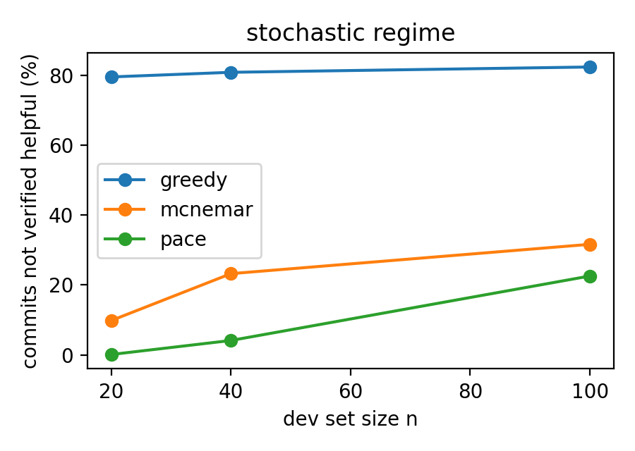

# harness-admission

**When should an automated edit to an LLM's prompt or harness be accepted?**
Self-improving LLM systems keep an edit when it scores higher on a development set. With small,
noisy evaluations, many of those "improvements" are not real. This repo reproduces **PACE**, an
anytime-valid paired commit gate, against greedy and McNemar acceptance, with real model outputs.

## Result

Qwen2.5-3B-Instruct (executor, fp16, Tesla T4) on GSM8K; Qwen2.5-7B-Instruct-AWQ proposes 30 system-prompt
edits from the base harness's failures. A known-real edit (removing a "no working" handicap) raises
audit accuracy from **16.8% to 87.5%**. Each edit is labelled on a held-out 400-item audit set by its paired
95% interval: *helpful* (interval above 0), *harmful* (below 0) or *null* (contains 0).
1,000 simulated self-improvement runs, dev set n = 40, stochastic regime (temperature 0.7, a fresh sample per evaluation):

| Gate | Commits per run | Helpful | Null | Harmful | Final audit gain |
|---|---|---|---|---|---|
| Greedy | 9.8 | 19.1% | 73.3% | 7.6% | +69.2 pts |
| McNemar (α = 0.05) | 1.5 | 76.7% | 21.5% | 1.8% | +69.1 pts |
| **PACE** (α = 0.05, λ = 0.5) | **1.1** | **95.9%** | 3.8% | **0.3%** | +68.9 pts |

Replicated with a second simulation seed: greedy 10.1 commits / 19.0% helpful; PACE 1.1 / 96.2%
(`results/table1_s1.csv`; same model outputs, different simulated runs).

What the ablations (`results/ablations.csv`) show:
- **Final accuracy is the same for every gate.** 27 of 30 proposed edits reach the planted edit's level, so every gate
  ends in the same place. Here a valid gate buys a *truthful commit log* (each accepted "improvement" is real), not a
  higher final score.
- **Dev-set reuse is not the cause.** Greedy with a fresh dev subset per candidate is no better
  (11.8 commits, 17.9% helpful). Its false commits come from evaluation noise between near-equal edits.
- **A fixed margin is a blunt fix.** Greedy with a 10-point margin (Ladder-style): 64% helpful; a 2-point margin is identical to greedy at n = 40.
- **Futility stopping saves ~20% of evaluation** at identical decisions (1,135 vs 1,413 items per run).
- **Prompt sensitivity.** Five meaning-preserving rewordings of the base prompt change audit accuracy by
  −5.8 to +11.7 points at temperature 0.
- **Stage 0 (simulation):** under the null, a t-test checked after every item falsely accepts 26.6% of edits;
  the PACE e-process 3.55% (`results/stage0.txt`).

Limitations: one model, one task, one obvious handicap, one proposer run. At n = 100 PACE's helpful share drops to
77% because it separates near-equal edits that a 400-item audit cannot resolve; that is a limit of the audit, not of the gate.

## Reproduce
- **Colab (T4):** open `colab_run.ipynb` and run cells 1–7 in order (~4 h).
- **Linux GPU:** `bash scripts/setup.sh && source .venv/bin/activate && bash scripts/run_all.sh`
- **CPU dry run, fake model:** `HA_FAKE=1 HA_HOME=$(mktemp -d) bash scripts/run_all.sh`
- Tests: `pytest -q` (20 tests).

Env vars: `HA_HOME` (where cache/configs/results go), `HA_DTYPE` (`half` on T4), `HA_GPU_UTIL`, `HA_FAKE=1`.

## Layout
`data/` pools · `harness/` harness + store · `runner/` executor, cache, answer extraction · `proposer/` LLM and manual edits ·
`gates/` greedy, McNemar, PACE · `sim/` run simulator · `analysis/` labels, tables · `sims/` stage-0 simulations ·
`scripts/` grid, stop check, diagnostics, report · `tests/`

## References
PACE (arXiv 2606.08106) · SEA: Self-Evolving Agents with Anytime-Valid Certificates (arXiv 2607.00871) ·
Dwork et al., *Generalization in Adaptive Data Analysis and Holdout Reuse* (2015) · Blum & Hardt, *The Ladder* (2015) ·
Bertran, Roth & Wu, *What Fits (Into Few Tokens) Doesn't Overfit* (arXiv 2606.11045)
